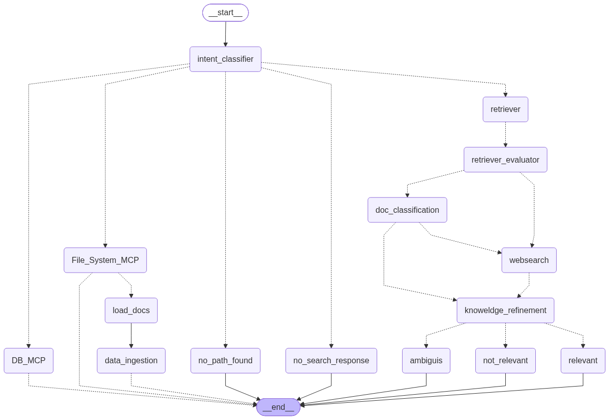

# Agentic RAG

A full-stack **Agentic Retrieval-Augmented Generation (RAG)** system that goes beyond a conventional retrieve-and-generate pipeline. The application uses a **LangGraph agent workflow** to understand user intent, route requests, retrieve and evaluate knowledge, use external tools through **MCP**, and generate grounded responses with source attribution.



## Overview

This project is designed as a local AI assistant that can work across multiple information sources. Depending on the user's request, the agent can:

- answer conversational questions without unnecessary retrieval;
- search and reason over indexed PDF documents;
- inspect and load documents from a configured local folder;
- query application data through a database MCP server;
- fall back to web search when local knowledge is insufficient;
- evaluate and refine retrieved evidence before generation;
- preserve chat history across conversations;
- stream both agent progress and generated tokens to the frontend.

The core idea is **dynamic routing**: retrieval, tools, and web search are invoked only when the agent determines they are useful.

## Architecture

The orchestration layer is implemented as a **LangGraph state graph**. A request first passes through intent classification and is then routed into the appropriate workflow.

```text
                         ┌───────────────────┐
                         │   User Request    │
                         └─────────┬─────────┘
                                   │
                         ┌─────────▼─────────┐
                         │ Intent Classifier │
                         └─────────┬─────────┘
                                   │
               ┌───────────────────┼───────────────────┐
               │                   │                   │
               ▼                   ▼                   ▼
        Document / Files          RAG             Database / Chat
               │                   │                   │
        Filesystem MCP      Hybrid Retrieval        Database MCP
               │            Vector + Keyword
        Load / Ingest PDF           │
               │                    ▼
               │          Retriever Evaluation
               │                    │
               │          Document Classification
               │                    │
               │        ┌───────────┴───────────┐
               │        │                       │
               │        ▼                       ▼
               │   Local Context           Web Search MCP
               │                                │
               │                        Knowledge Refinement
               │                                │
               └────────────────────────────────┼─────────────
                                                ▼
                                      Response Generation
                                                │
                                                ▼
                                       Streamed Response
```

## Key Features

- **Agentic routing** — classifies requests and dynamically chooses the appropriate execution path.
- **Hybrid retrieval** — combines semantic vector search with keyword search.
- **Reciprocal Rank Fusion (RRF)** — merges and re-ranks results from multiple retrievers.
- **Retrieval evaluation** — evaluates retrieved evidence before using it for generation.
- **Knowledge refinement** — distinguishes relevant, irrelevant, and ambiguous evidence.
- **Web fallback** — uses a Tavily-backed MCP web-search tool when document context is insufficient.
- **MCP tool layer** — separate filesystem, database, and web-search MCP servers and clients.
- **Document ingestion** — discovers, loads, chunks, embeds, and stores PDF documents.
- **Duplicate protection** — skips documents already present in the database.
- **Human-in-the-loop document selection** — LangGraph interrupts allow confirmation before document ingestion.
- **Persistent chat history** — PostgreSQL-backed conversations and message history.
- **Streaming UI** — FastAPI Server-Sent Events stream live agent stages, tokens, messages, and sources.
- **Source attribution** — responses can expose the documents or web sources actually used.
- **Embedding fallback** — supports Hugging Face inference with Gemini embedding fallback.
- **Local web interface** — lightweight HTML/CSS/JavaScript frontend.

## Retrieval Pipeline

The retrieval subsystem uses two independent retrieval signals:

```text
User Query
   │
   ├──────────────► Semantic / Vector Search ──┐
   │                                           │
   └──────────────► Keyword Search ────────────┤
                                               ▼
                                  Reciprocal Rank Fusion
                                               │
                                               ▼
                                          Top-K Chunks
                                               │
                                               ▼
                                    Retrieval Evaluation
```

RRF allows the system to combine rankings without requiring the raw scores produced by the two retrieval methods to be directly comparable.

## Tech Stack

| Layer | Technology |
| --- | --- |
| Agent orchestration | LangGraph |
| LLM / AI integration | LangChain, Google Gemini, Groq |
| Tool protocol | MCP, FastMCP |
| API | FastAPI |
| Streaming | Server-Sent Events / async streaming |
| Retrieval | Semantic search + keyword search + RRF |
| Embeddings | Qwen3 Embedding via Hugging Face, Gemini Embeddings |
| Vector / relational storage | PostgreSQL |
| Web search | Tavily |
| PDF processing | PyMuPDF, PyPDF |
| Frontend | HTML, CSS, JavaScript |
| Python environment | uv |

## Project Structure

```text
Agentic-RAG/
├── assets/
│   └── architecture.png
├── backend/
│   ├── agent/
│   │   ├── fallback/
│   │   ├── start/
│   │   ├── states/
│   │   └── graph.py
│   ├── config/
│   ├── documents/
│   │   ├── graph/
│   │   └── ingestion/
│   ├── mcp/
│   │   ├── clients/
│   │   └── servers/
│   ├── rag/
│   │   ├── generation/
│   │   ├── refinement/
│   │   └── retrieval/
│   └── app.py
├── db_setup/
│   ├── chat_history_tables/
│   ├── db_creation.py
│   ├── db_pipeline.py
│   └── table_creation.py
├── frontend/
│   ├── app.js
│   ├── index.html
│   └── style.css
├── src/
│   └── agentic_rag/
├── pyproject.toml
├── uv.lock
└── README.md
```

## Getting Started

### Prerequisites

The project currently declares **Python 3.14+** and uses **uv** for dependency management. You also need a running PostgreSQL installation and API credentials for whichever external model/search providers you enable.

### 1. Clone the repository

```bash
git clone https://github.com/Naeem-Mubarak/Agentic-RAG.git
cd Agentic-RAG
```

### 2. Install dependencies

With `uv` installed:

```bash
uv sync
```

### 3. Configure environment variables

Create a `.env` file in the project root and provide the credentials/configuration required by your selected providers and PostgreSQL setup.

The codebase integrates with:

- Hugging Face for Qwen embeddings;
- Google Gemini for embeddings/model access;
- Groq for model access;
- Tavily for web search;
- PostgreSQL for document vectors and chat persistence.

> Keep API keys and database credentials out of source control. The repository's `.gitignore` should be used to exclude local secrets.

### 4. Initialize PostgreSQL

The database setup modules live under `db_setup/`. They create the project database/tables used for document storage and persistent chat history.

Run the setup after configuring the database values expected by `backend/config/config.py`:

```bash
uv run python -m db_setup.db_pipeline
```

### 5. Start the backend

```bash
uv run uvicorn backend.app:app --reload
```

FastAPI will expose the backend locally (Uvicorn defaults to port `8000`).

### 6. Open the frontend

Serve the `frontend/` directory with any static HTTP server. For example:

```bash
python -m http.server 5500 --directory frontend
```

Then open `http://localhost:5500` in your browser.

## Document Ingestion

The ingestion workflow is intentionally agent-driven:

1. Configure the local documents folder from the application.
2. The filesystem MCP server discovers available PDFs.
3. The agent asks which documents should be loaded.
4. Selected files are checked against the database to avoid duplicate ingestion.
5. PDF content is extracted and split into chunks.
6. Embeddings are generated in batches.
7. Chunks, metadata, page numbers, document names, and vectors are stored in PostgreSQL.
8. The indexed content becomes available to the hybrid retriever.

The embedding layer attempts **Qwen/Qwen3-Embedding-8B** through Hugging Face when configured and can fall back to **Gemini Embedding**.

## Agent Workflow

The graph includes specialized nodes for:

- intent classification;
- query routing;
- filesystem access;
- document loading and ingestion;
- database operations;
- hybrid retrieval;
- retrieval evaluation;
- document classification;
- web search;
- knowledge refinement;
- relevant / irrelevant / ambiguous response generation;
- direct conversational responses when retrieval is unnecessary.

LangGraph's checkpointer also maintains graph state per thread, enabling interrupted workflows such as document-selection confirmation to resume correctly.

## API Highlights

The FastAPI backend provides endpoints for application settings, folder browsing, chat creation/loading/deletion, recent prompts, file uploads, and streamed message execution.

The primary conversational path uses **SSE streaming**. The server emits real execution-stage updates from LangGraph nodes and streams generated tokens only from user-facing generation nodes. This keeps internal classifier/tool activity separate from the final answer while still giving the UI useful progress feedback.

## Design Goals

This project focuses on engineering a RAG system that can **decide what to do**, rather than blindly running retrieval for every message. The architecture separates orchestration, retrieval, ingestion, tools, generation, persistence, and UI concerns so that individual components can evolve independently.

## Current Status

The project is under active development. Interfaces, configuration, model providers, and individual graph nodes may change as the architecture evolves.

## License

This repository is licensed under the terms provided in the [LICENSE](LICENSE) file.

## Author

**Naeem Mubarak**

Built as an engineering-focused exploration of agentic AI, Retrieval-Augmented Generation, LangGraph, MCP, hybrid search, and production-oriented LLM application architecture.
